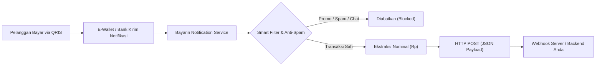

# Bayarin - Merchant Notification Forwarder 🚀

<div align="center">


**Aplikasi Android untuk meneruskan notifikasi pembayaran QRIS, e-wallet, dan transaksi merchant ke webhook / REST API server secara real-time.**

*Dikembangkan oleh **Febriansyah** ([@febzofc](https://github.com/febzofc))*

---
</div>

## 📥 Unduh Aplikasi

> ⚠️ **Penting:** matikan **Google Play Protect** agar APK bisa langsung dipasang tanpa ADB. Aplikasi ini open source — kode dan APK-nya bisa Anda verifikasi sendiri.

APK siap pasang tersedia di halaman **[Releases](https://github.com/febzofc/merchant-notification-forwarder/releases/latest)**.

1. Buka halaman **Releases**, lalu unduh berkas `Bayarin-vX.Y.apk` pada bagian *Assets*.
2. Pindahkan ke perangkat Android, lalu pasang (*install*). Karena APK ini tidak diunduh dari Play Store, Anda perlu mengizinkan **Install unknown apps** untuk aplikasi pengelola berkas/browser yang Anda gunakan. Jika muncul *"App blocked to protect your device"*, lihat [bagian Play Protect](#memasang-langsung-dari-browser-nonaktifkan-play-protect) atau gunakan ADB di bawah.
3. Jika pernah memasang versi **v1.0** (yang ditandatangani debug key), **uninstall dulu** — kunci penandatanganannya berbeda sehingga update tidak akan terpasang.
4. Lanjutkan ke [Panduan Instalasi & Penggunaan](#-panduan-instalasi--penggunaan) bagian konfigurasi izin.

> **Keamanan:** mulai v1.1, APK ditandatangani dengan kunci rilis tetap dan hanya menerima webhook **HTTPS**. Fingerprint SHA-256 signer dicantumkan pada catatan setiap rilis — cocokkan dengan `apksigner verify --print-certs Bayarin-vX.Y.apk` untuk memastikan APK tidak dimodifikasi. Trafik HTTP biasa diblokir, dan hanya sertifikat sistem yang dipercaya.

> **Distribusi:** keystore rilis disimpan sebagai secret GitHub (`KEYSTORE_BASE64`, `STORE_PASSWORD`, `KEY_PASSWORD`, `KEY_ALIAS`), tidak pernah masuk repo.

### Kenapa APK dari browser sering diblokir Play Protect?

Google Play Protect memblokir otomatis aplikasi yang di-sideload dari browser/WhatsApp/file manager **jika** mendeklarasikan izin sensitif — dan `BIND_NOTIFICATION_LISTENER_SERVICE` termasuk di dalamnya ([developer guidance](https://developers.google.com/android/play-protect/warning-dev-guidance)). Pemicunya adalah izin + sumber instalasi, bukan tanda tangan APK. Karena itu jalur distribusi yang benar adalah:

| Jalur | Status | Catatan |
|---|---|---|
| `adb install -r -d Bayarin-vX.Y.apk` | ✅ | Bukan "internet-sideloading source". Untuk provisioning perangkat sendiri. |
| Play Console **internal testing** | ✅ | Maks 100 tester, tanpa review, tersedia dalam hitungan menit. Upload `Bayarin-vX.Y.aab`. |
| Managed Google Play **private app** | ✅ | Tanpa review publik, untuk organisasi/merchant dengan perangkat terkelola. |
| Browser / WhatsApp / file manager | ❌ | Selalu diblokir dan tidak bisa diakali. |

Setiap rilis GitHub juga menyertakan berkas `.aab` untuk diunggah ke Play Console.

### Provisioning cepat lewat ADB (gratis)

```bash
./scripts/provision-adb.sh Bayarin-v1.2.apk
```

Skrip ini memasang APK, memberi akses Notification Listener, mengizinkan notifikasi, dan mengecualikan aplikasi dari optimasi baterai — tanpa perlu menyentuh Play Protect. Jalankan untuk setiap perangkat merchant.

### Memasang langsung dari browser: nonaktifkan Play Protect

Jika tidak ada PC untuk ADB, Play Protect bisa dinonaktifkan sementara di perangkat **milik Anda sendiri** agar APK dapat dipasang dari browser/file manager:

1. Buka **Play Store** → foto profil kanan atas → **Play Protect**
2. Ketuk ikon **gerigi** (Pengaturan)
3. Matikan **"Pindai aplikasi dengan Play Protect"**
4. Jika tersedia, matikan juga **"Tingkatkan deteksi aplikasi berbahaya"**
5. Pasang `Bayarin-vX.Y.apk`, lalu pilih **"Install anyway"** bila muncul
6. Setelah terpasang, pemindaian boleh diaktifkan kembali

Jika masih diblokir, sumbernya biasanya aplikasi keamanan bawaan vendor, bukan Play Protect:

| Merek | Yang perlu dimatikan |
|---|---|
| Infinix / Tecno / itel | **Phone Master** → App Shield / pemindaian instalasi |
| Xiaomi / Redmi (HyperOS) | Security → **Auto Blocker** |
| Samsung | Settings → Security and privacy → **Auto Blocker** |
| Oppo / Realme | Security → **App Security Scan** / Payment Protection |
| Vivo | iManager → **Installation guard** |

> ⚠️ **Peringatan:** menonaktifkan Play Protect melemahkan perlindungan perangkat terhadap aplikasi berbahaya. Lakukan hanya pada perangkat yang Anda miliki/kelola, dan beri tahu pemilik perangkat. Untuk distribusi massal, gunakan ADB atau Play Console — jangan meminta pengguna mematikan proteksinya.

---

## 📌 Tentang Aplikasi

**Bayarin** adalah solusi jembatan (*bridge*) otomatis bagi para pemilik toko (*merchant*), developer kasir (POS), dan pegiat automasi pembayaran di Indonesia. Aplikasi ini berjalan di latar belakang (*background service*) menggunakan Android `NotificationListenerService` untuk menangkap notifikasi transaksi masuk (seperti dari **GoPay / GoBiz**, **DANA**, **OVO**, **ShopeePay**, **LinkAja**, maupun perbankan seperti **BCA** dan **Livin' Mandiri**) lalu mengirimkannya secara instan dalam format JSON ke URL Webhook yang Anda tentukan.

---

## ✨ Fitur Utama

- ⚡ **Real-time Forwarding**: Notifikasi pembayaran langsung diteruskan ke webhook dalam hitungan milidetik setelah diterima.
- 🔁 **Anti-Duplikat**: Satu notifikasi pembayaran hanya dikirim **sekali**. Update notifikasi dari aplikasi sumber diabaikan, dan notifikasi milik Bayarin sendiri tidak pernah ikut diteruskan (mencegah loop tanpa henti ke webhook).
- 🛡️ **Smart Anti-Spam & Promo Filter**:
  - Memfilter dan memblokir notifikasi promo, voucher diskon, cashback, DANA Kaget, pinjaman/paylater, dan pesan marketing.
  - Memastikan hanya notifikasi transaksi pembayaran sah yang diteruskan ke server Anda.
- 💰 **Auto Extract Amount**: Mengekstrak nominal pembayaran (`Rp` / `IDR`) secara otomatis ke format angka numerik (`Long`).
- 🎯 **Mode Penyaringan Fleksibel**:
  - **GoPay & DANA** (Rekomendasi untuk UMKM)
  - **Semua QRIS & E-Wallet** (GoPay, DANA, OVO, ShopeePay, LinkAja, BCA, Livin by Mandiri)
  - **Semua Aplikasi** (Meneruskan semua notifikasi sistem)
  - **Custom Package Name** (Filter aplikasi berdasarkan *package name* spesifik, contoh: `com.whatsapp`)
- 🧪 **Simulator & Pengujian Langsung**:
  - Uji koneksi Webhook langsung dari dalam aplikasi.
  - Simulasi validasi filter pembayaran QRIS vs pesan promo tanpa perlu menunggu transaksi asli.
- 📜 **Log Aktivitas & Riwayat Transaksi**:
  - Memantau status pengiriman (`SUCCESS`, `FAILED`, `SENDING`).
  - Menampilkan kode status HTTP response dan pesan balasan dari server Anda.
- 🔋 **Panduan Optimalisasi Baterai**: Dilengkapi panduan izin latar belakang untuk berbagai vendor Android (Infinix, Xiaomi, Samsung, Oppo, Vivo) agar layanan tidak dimatikan oleh sistem.

---

## 🏗️ Alur Kerja (Workflow)



---

## 📡 Format Payload Webhook

Setiap kali notifikasi yang valid diterima, aplikasi akan mengirimkan HTTP POST request dengan header `Content-Type: application/json; charset=utf-8` dan `User-Agent: Bayarin-Forwarder/1.0`:

```json
{
  "app": "Bayarin",
  "id": 101,
  "uniqueId": "id.dana_101_1729345200000",
  "provider": "DANA",
  "packageName": "id.dana",
  "title": "DANA Bisnis",
  "text": "Pembayaran QRIS Rp 50.000 berhasil diterima dari BUDI",
  "message": "Pembayaran QRIS Rp 50.000 berhasil diterima dari BUDI",
  "rawText": "DANA Bisnis: Pembayaran QRIS Rp 50.000 berhasil diterima dari BUDI",
  "amount": 50000,
  "nominal": 50000,
  "subText": "",
  "postTime": 1729345200000,
  "timestamp": 1729345200150
}
```

### Keterangan Field:
| Field | Tipe Data | Keterangan |
|---|---|---|
| `app` | String | Nama aplikasi pengirim (`Bayarin`) |
| `id` | Integer | ID internal notifikasi Android |
| `uniqueId` | String | Identitas unik notifikasi (`package_id_timestamp`) |
| `provider` | String | Provider terdeteksi (`DANA`, `GOPAY`, `OVO`, `SHOPEEPAY`, `LINKAJA`, `QRIS`, `OTHER`) |
| `packageName`| String | Package name aplikasi sumber (misal: `id.dana` atau `com.gojek.gobiz`) |
| `title` | String | Judul notifikasi |
| `text` / `message` | String | Isi teks notifikasi |
| `rawText` | String | Gabungan judul dan isi notifikasi |
| `amount` / `nominal` | Long | Nominal uang yang berhasil diekstrak (dalam integer murni) |
| `postTime` | Long | Timestamp saat notifikasi dibuat di sistem Android |
| `timestamp` | Long | Timestamp saat forwarder mengirimkan data |

---

## 🚀 Panduan Instalasi & Penggunaan

### 1. Prasyarat
- Perangkat Android dengan OS **Android 7.0 (Nougat / API 24)** atau lebih tinggi.
- Server penerima webhook dengan endpoint aktif (contoh: webhook Discord, Telegram bot bridge, endpoint Node.js, Laravel, Go, dsb.).

### 2. Konfigurasi Izin di HP
Agar forwarder dapat berjalan lancar tanpa terhenti:
1. **Izin Akses Notifikasi**: Buka aplikasi, klik banner peringatan atau tombol **Buka Pengaturan Notifikasi**, lalu aktifkan **Bayarin Notification Forwarder**.
2. **Izin Aplikasi Berbahaya / Khusus (Android 13+)**:
   - Jika tombol akses notifikasi berwarna abu-abu (*Restricted Setting*):
   - Masuk ke *Settings > Apps > Bayarin > Titik tiga di pojok kanan atas > Allow restricted settings*.
3. **Pengecualian Optimasi Baterai**:
   - Izinkan Bayarin berjalan tanpa batasan latar belakang (*No restrictions / Unrestricted battery*).
4. **Auto-start**:
   - Di perangkat Infinix, Xiaomi, Oppo, Vivo, pastikan Bayarin diberi izin *Autostart* dan dikunci pada menu Recent Apps.

### 3. Konfigurasi Webhook
1. Masukkan URL endpoint server Anda pada kolom **URL Webhook Server**.
2. Klik tombol **Uji Koneksi** untuk memverifikasi server Anda merespons dengan HTTP status 200.
3. Klik **Simpan Pengaturan**.

---

## 🛠️ Kompilasi dari Source Code

Aplikasi ini dibangun menggunakan stack Android modern:
- **Language**: Kotlin 2.2.10
- **Build System**: Gradle 9+ (Kotlin DSL)
- **UI Toolkit**: Jetpack Compose & Material 3
- **Network**: OkHttp3 & Retrofit

### Langkah Build APK:
```bash
# Clone repository
git clone https://github.com/febzofc/merchant-notification-forwarder.git
cd merchant-notification-forwarder

# Build APK Debug via Gradle
./gradlew assembleDebug

# Output APK akan berada di:
# app/build/outputs/apk/debug/app-debug.apk
```

### Membuat Rilis Baru (Otomatis)

Rilis dipublikasikan otomatis oleh GitHub Actions (`.github/workflows/release.yml`). Cukup buat dan push tag:

```bash
git tag v1.0
git push origin v1.0
```

Setelah tag terkirim, GitHub akan otomatis:
1. Menyiapkan JDK, Android SDK, dan Gradle,
2. Membangun APK debug (`assembleDebug`),
3. Membuat GitHub Release bernama sesuai tag, dan
4. Melampirkan APK tersebut sebagai aset rilis.

Anda juga bisa menjalankannya manual dari tab **Actions → Build & Release APK → Run workflow** dengan mengisi nama tag.

---

## 🔒 Privasi & Keamanan

- **100% Direct Forwarding**: Data notifikasi dikirimkan langsung dari perangkat Android Anda ke endpoint webhook yang Anda tentukan sendiri.
- **Tanpa Server Pihak Ketiga**: Aplikasi ini tidak menggunakan layanan perantara pihak ketiga, analitik tersembunyi, ataupun pelacak data pengguna.
- **Transparan**: Seluruh kode sumber terbuka (*open source*) dan dapat diaudit secara bebas.

---

## 👨‍💻 Kontributor & Kredit

Aplikasi ini dirancang, dikembangkan, dan dipelihara oleh:

**Febriansyah**
- GitHub: [@febzofc](https://github.com/febzofc)
- Repository: [merchant-notification-forwarder](https://github.com/febzofc/merchant-notification-forwarder)

---

## 📄 Lisensi

Proyek ini dirilis di bawah lisensi [MIT License](LICENSE). Bebas digunakan, dimodifikasi, dan didistribusikan untuk keperluan pribadi maupun komersial.
